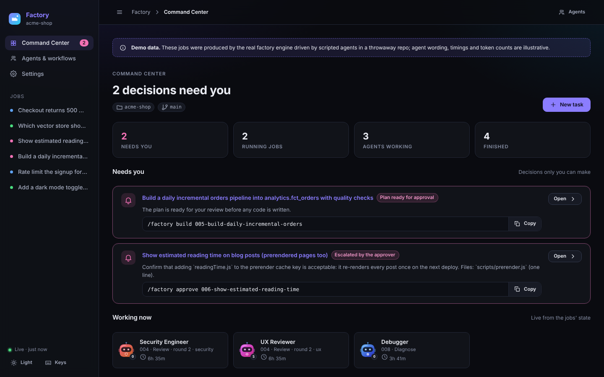
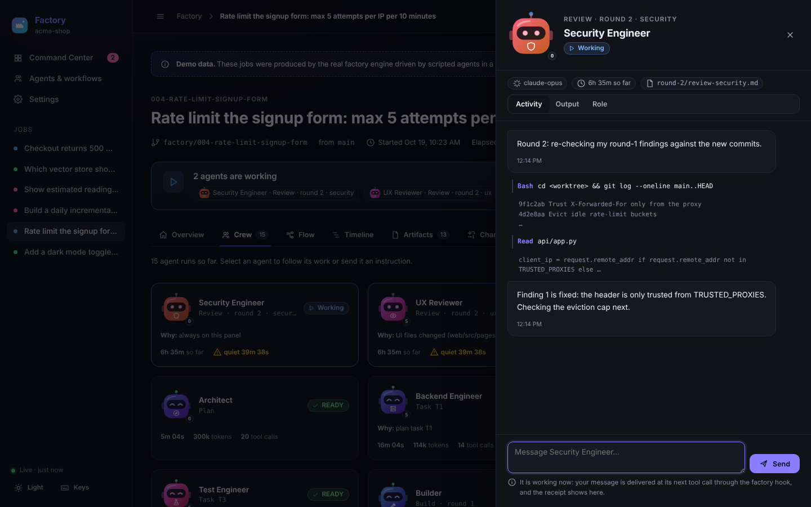
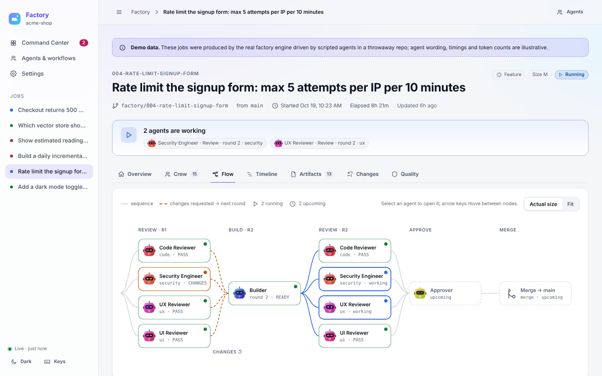
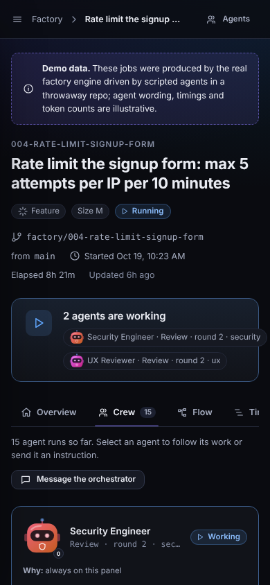

# Software Factory for Claude Code

Type `/factory <what you want>` in Claude Code. A team of specialist agents specifies it, plans it, builds it on its
own branch, reviews it from every angle that matters for that change, and either merges it locally or stops and asks
you — with every step, verdict and message visible as it happens.

This is a production rebuild of the ZazenCodes "software factory" (one skill, seven agents; kept untouched in
[`upstream/`](upstream/)) into a multi-discipline engineering factory: 25 agents across product, build, data,
infrastructure, quality and security; 11 workflows; a deterministic, tested orchestration engine; safety hooks; a web
console where every agent has its own robot avatar and you can talk to any of them mid-run; and an in-terminal board
built on Claude Code's mod API.



## What you get

- **`/factory`** — one command for the whole lifecycle: `/factory <request>` picks the workflow and size and says
  why; or name it: `/factory fix …`, `/factory data …`, `/factory infra …`, `/factory research …`.
- **25 agents with explicit contracts** ([docs/AGENTS.md](docs/AGENTS.md)) — product analyst, researcher, codebase
  analyst, architect, builder, frontend/backend engineers, debugger, data architect, SQL engineer, data engineer
  (ETL/ELT, Spark), data-quality engineer, cloud architect, IaC engineer, platform engineer, SRE, test architect,
  test engineer, code reviewer, security engineer, performance engineer, UX and UI reviewers, docs engineer, approver.
- **11 workflows** ([docs/WORKFLOWS.md](docs/WORKFLOWS.md)) — feature, fix, quick, research, review (audit), data,
  infra (plan approval, never applies, always escalates), refactor (characterisation tests first), perf, security,
  docs.
- **A deterministic engine** (`factoryctl`, Python stdlib) that owns every rule — transitions, limits, contracts,
  review panels, plans, merges — so the LLM orchestrator only executes one action at a time and a crashed session can
  be resumed exactly where it stopped.
- **Dynamic review panels** — code and security always; UX and UI only when UI changes; performance for perf and data
  work. Each pick says why. Rounds wait for every reviewer; at most three.
- **Talk to any agent while it works** — from the console, the terminal board or `/factory tell`. Messages reach a
  running agent at its next tool call, or its next prompt if it has finished; every receipt is shown.
- **Factory Console** — `/factory dashboard`: Command Center, job workspace (overview, crew and chat, orchestration
  graph, timeline, artifacts, diff, quality), catalog and settings. Light and dark, keyboard-first, WCAG 2.1 AA
  (axe-tested), responsive down to phones. No build step, no CDN, nothing leaves your machine.
- **factory-live** (optional) — the factory inside Claude Code: a status line, a band when a job needs you, a
  `/factory-board` pane with every agent at work, Watch (open its transcript) and Message.
- **Safety by construction** — the factory never pushes, deploys, publishes or applies infrastructure. A guard hook
  denies catastrophic commands and asks before risky ones; reviewers cannot edit code; approved jobs merge locally;
  money, access, deploy/CI, migrations, production data, new dependencies and product decisions always go to you.

| Talk to an agent mid-run | The job as a graph | On a phone |
|---|---|---|
|  |  |  |

<sub>Screenshots are `factoryctl serve --demo`: the real engine driven by scripted agents in a throwaway repository.</sub>

## Quick start

Requirements: Claude Code, Python ≥ 3.9, git. Optional: Node 20+ (browser tests), `gh` (`--from-issue`).

```bash
git clone https://github.com/theabgupta1/software-factory && cd software-factory
scripts/verify-local.sh        # every deterministic test, then a dry run of the install (no model calls)
scripts/install.sh             # installs into ~/.claude/skills (backs up anything it replaces)
```

Then, in any repository:

```text
/factory init
/factory Add a rate limit to the signup form: 5 attempts per IP per 10 minutes
/factory dashboard              # the Factory Console, in your browser
/factory-board                  # the board inside Claude Code (factory-live)
```

Or install from the marketplace: `/plugin marketplace add theabgupta1/software-factory`, then
`/plugin install factory@software-factory` (and `factory-live@software-factory`). Details, upgrade and removal:
[docs/INSTALL.md](docs/INSTALL.md).

## How it works

```text
/factory <request>
  orchestrator (your Claude Code session, following the /factory skill)
    picks workflow + size → factoryctl new
    loop: factoryctl next <job> → ONE action
            spawn    agents (several in one message run in parallel)
            message  resume the builder with the review round
            inline   a small step for the orchestrator itself (worktree setup)
            human    stop and tell you exactly what to decide, with the command
            done     merged / delivered / cancelled
          factoryctl done <job> <step>   checks the agent's output contract, advances the job
```

Each job gets a git worktree and a `factory/<job>` branch, so jobs run side by side without touching your checkout.
All state is plain files under `.factory/` (excluded from git): `job.json`, an append-only event log, messages,
and every artifact the agents write. More in [docs/ARCHITECTURE.md](docs/ARCHITECTURE.md).

## Commands

| | |
|---|---|
| `/factory <request>` · `/factory <workflow> <request>` | start a job (`--size S\|M\|L`, `--from-issue N`) |
| `/factory next [--all]` | build the next backlog item (or all of them) |
| `/factory status [job]` · `/factory report <job>` | board · final report |
| `/factory approve <job>` · `/factory build <job>` | approve an escalation · approve a plan |
| `/factory rework <job> <note>` | send it back with a note |
| `/factory tell <job> <agent\|orchestrator> <message>` | steer an agent mid-run |
| `/factory resume <job>` · `/factory cancel <job>` | take over after a crash · stop |
| `/factory dashboard` · `/factory doctor` | console · environment check |

## Configure (optional)

`.factory/config.json` in a repository: `base_branch`, `auto_merge` (default on, local only), `deliver`
(`merge` or `branch` — stop with a ready branch and the exact `git push`/`gh pr create` commands for you to run),
`require_plan_approval`, `always_escalate` (path globs), `limits`, `models` (per-agent model overrides),
`worktree.copy` / `worktree.setup` (files to copy and commands to run in each new worktree), `stall_minutes`.
`.factory/standards.md` is given to every agent; `.factory/prompts/<agent>.md` adds instructions for one agent.

## Testing

```bash
scripts/test.sh            # every layer that can run here
scripts/test.sh --matrix   # … and docs/TEST-MATRIX.md from the results
scripts/eval.sh            # agent-quality evals with real model runs (paid, capped, asks first)
```

Layers: static (manifests, contracts, generated files, `claude plugin validate`), unit, integration (every workflow,
failure and resume path with scripted agents in temp repos), end-to-end through the CLI, installer against throwaway
Claude homes, eval suite offline, console logic in Node, factory-live under `claude plugin test` on four surfaces,
and the console in Chromium (journeys, axe in both themes, three widths, keyboard, XSS, error states). The current
results, including what was not run and why, are in [docs/TEST-MATRIX.md](docs/TEST-MATRIX.md). See
[docs/TESTING.md](docs/TESTING.md).

## Repository layout

```text
.claude-plugin/marketplace.json   the marketplace: factory, factory-live
plugins/factory/                  the plugin: skill, agents, hooks, engine (lib/), workflows, contracts, console (ui/), evals
plugins/factory-live/             the mod: status line, band, board pane
scripts/                          install, uninstall, test, eval, verify-local, generators
tests/                            static, unit, integration, e2e, install, evals, js, ui
docs/                             architecture, design system, agents, workflows, testing, security, ADRs
upstream/                         the original factory, untouched (reference and regression fixtures)
```

## Documentation

[Architecture](docs/ARCHITECTURE.md) · [Agents](docs/AGENTS.md) · [Workflows](docs/WORKFLOWS.md) ·
[Design system & UX](docs/DESIGN-SYSTEM.md) · [Testing](docs/TESTING.md) · [Test matrix](docs/TEST-MATRIX.md) ·
[Install](docs/INSTALL.md) · [Troubleshooting](docs/TROUBLESHOOTING.md) · [Migration from the original](docs/MIGRATION.md) ·
[Security](docs/SECURITY.md) · [Assessment of the original](docs/ASSESSMENT.md) · [Decisions (ADRs)](docs/adr/) ·
[Plan](docs/PLAN.md)

## Credits

Built on the ideas of the [ZazenCodes software factory](https://github.com/zazencodes/zazencodes-season-3/tree/main/src/software-factory-claude-code)
(machine-checkable verdict lines, one worktree per job, wait-for-all review rounds, the approver's escalation list).
Several features were adapted from [mattpocock/sandcastle](https://github.com/mattpocock/sandcastle): copy-on-write
worktree setup, engine-computed prompt context, repository standards, branch delivery, stall detection and issue
intake ([docs/PLAN.md §10](docs/PLAN.md)).

## License

MIT for everything in this repository except `upstream/`, which is a snapshot of the original project kept for
reference and carries that project's own terms (see [upstream/NOTICE.md](upstream/NOTICE.md)).
